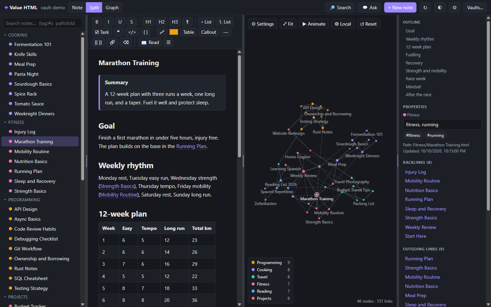
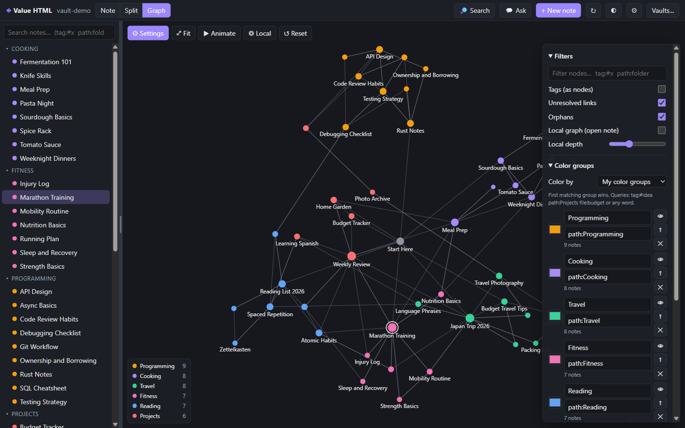
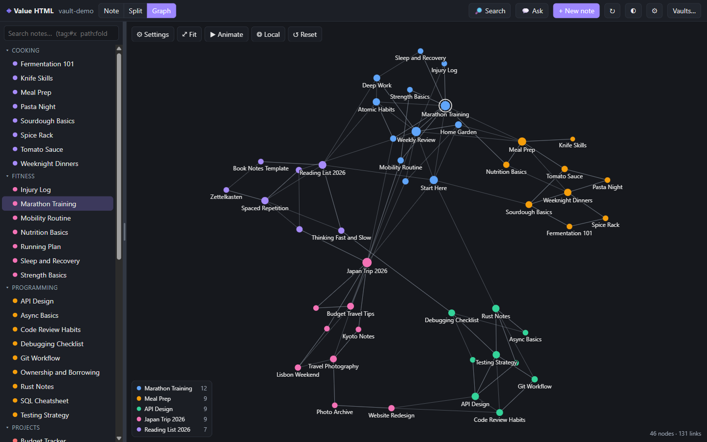
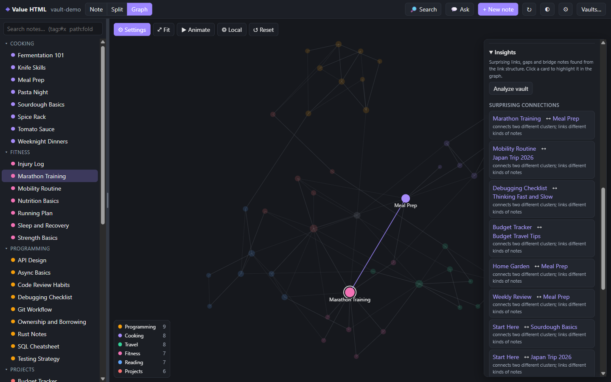
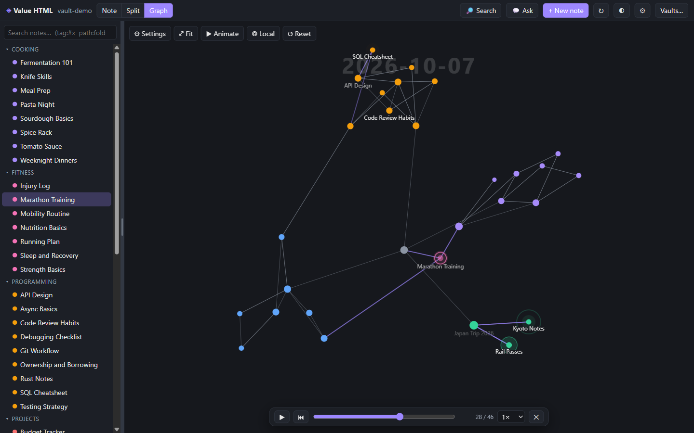
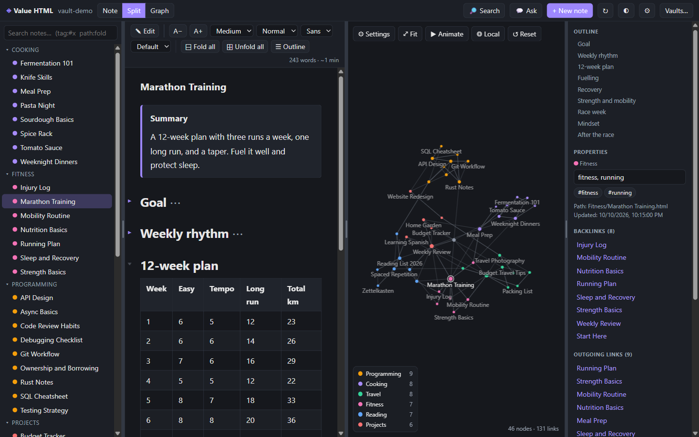
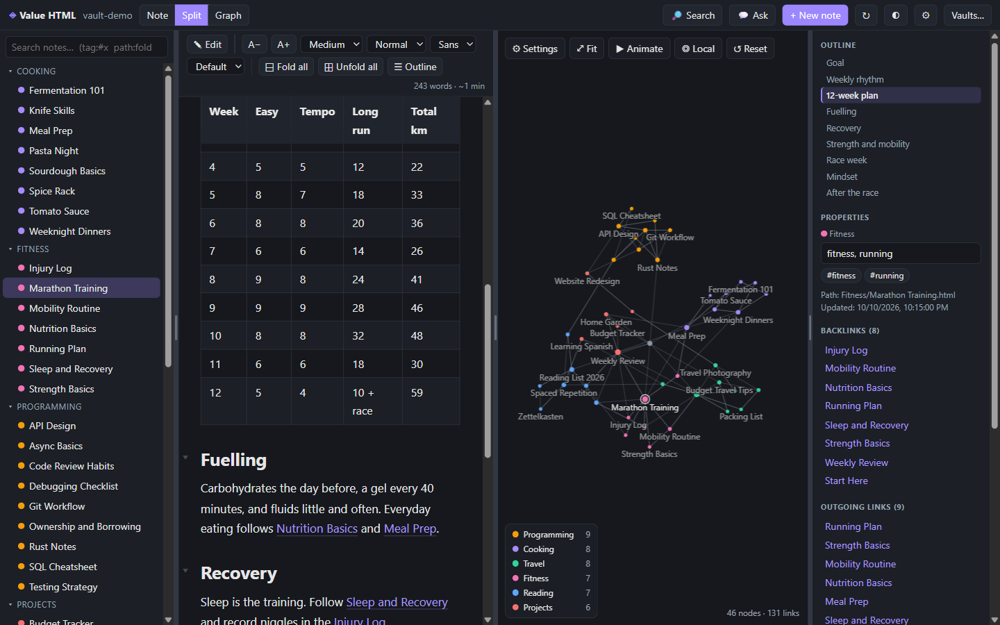
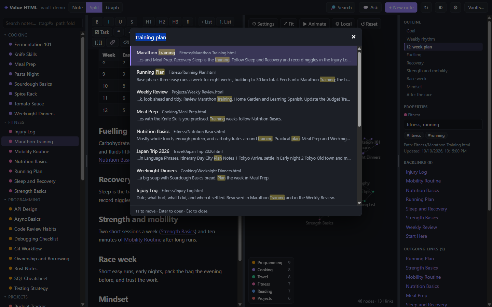

# Value HTML

**A graph notebook for Windows where every note is a real, readable `.html` file.**
Write with a rich editor, link notes with `[[double brackets]]`, and explore how your ideas connect, color-coded and animated.
Your notes stay plain files in a folder you choose: open any of them in a browser, back them up with anything, and never get locked in.



*The screenshots in this guide use a fictional demo vault, included in this repository as [`examples/demo-vault`](examples/demo-vault).*

---

## Contents
[Install](#install) · [Quick start](#quick-start) · [Writing notes](#writing-notes) · [The graph](#the-graph) · [Replay your vault growing](#replay-your-vault-growing) · [Reading long notes](#reading-long-notes) · [Search](#search) · [Ask your notes (AI)](#ask-your-notes-ai) · [Import from Markdown / Obsidian](#import-from-markdown--obsidian) · [Layout](#layout) · [Local API](#local-api-for-ai-agents) · [Keyboard shortcuts](#keyboard-shortcuts) · [Where your data lives](#where-your-data-lives) · [Build from source](#build-from-source)

---

## Install

**Requirements:** Windows 10 or 11 (64-bit).

1. Download from the [latest release](../../releases/latest):
   - `Value-HTML-Setup-0.2.0.exe`: installer (per user; you choose the folder; adds Start Menu and desktop shortcuts)
   - `Value-HTML-0.2.0-portable.exe`: no installation, just run it
2. Check the download if you like: `certutil -hashfile <file> SHA256` and compare with `SHA256SUMS.txt`.

> **The builds are not code-signed.** Windows SmartScreen may warn you: choose **More info, then Run anyway**.
> **Smart App Control** blocks unsigned apps outright and cannot be bypassed per app. If it stops the installer, [run from source](#build-from-source) instead. It takes two commands.
>
> The 0.2.0 installer was built before the reading tools (outline, reading mode, folding) and a few fixes described below. To get those, run from source or wait for the next release.

## Quick start

1. Start the app. Choose **Open a vault folder** and pick any folder (an empty one is fine), or choose **Try the demo vault** for a small built-in sample.
2. Click **+ New note**, give it a name, and write. It saves by itself a moment after you stop typing.
3. Type `[[` to link to another note. Links to notes that do not exist yet appear as dashed "ghost" nodes in the graph, and clicking one offers to create it.
4. Click **Split** or **Graph** at the top to see your notes as a graph.

**Want to see everything in this guide first?** Copy [`examples/demo-vault`](examples/demo-vault) somewhere, then **Vaults… → Open a vault folder**. Copy it first: the app writes a small settings file next to your notes.

The top bar switches between **Note**, **Split** (note and graph side by side) and **Graph**. The ◐ button toggles light and dark.

---

## Writing notes

The editor shows your note as it will look, and the toolbar covers what you need: bold, italic, underline, strikethrough, headings, bullet / numbered / task lists, quotes, inline code, code blocks, highlight, text color, tables, callouts, dividers, note links and web links. You can paste images straight in.

| To do this | Do this |
|---|---|
| New note | **+ New note** (`Ctrl+Alt+N`). Type `Folder/Name` to create it inside a folder |
| Link to a note | Type `[[`, then pick from the list. `[[Note\|label]]` shows different link text |
| Tag a note | Type `#idea` in the text, or fill in the tags box in the right-hand panel |
| Rename a note | Edit the title. The file is renamed and **every link to it is updated** |
| Open a link | Click it |
| Delete a note | **Delete note** in the right-hand panel |

The right-hand panel also shows **backlinks** (who links here), **outgoing links**, and **related notes**, ranked by shared links, shared tags and common neighbours.

### Notes are ordinary HTML

Each note is one `.html` file. The title, tags and dates live in `<meta>` tags, and links are normal relative links, so your notes still work if you stop using the app:

```html
<meta name="hv:tags" content="food, dinner">
<meta name="hv:created" content="2026-10-02T12:15:00.000Z">
...
<article>
<h1 class="note-title">Pasta Night</h1>
<p>Friday is pasta night. Rotate between
   <a class="wikilink" data-link="Tomato Sauce" href="Tomato%20Sauce.html">Tomato Sauce</a>, pesto and aglio e olio.</p>
</article>
```

---

## The graph

Every note is a node and every link is a line. Drag nodes, scroll to zoom, drag the background to pan, hover to highlight a note and its neighbours, and click a note to open it. **Fit** re-frames the graph, **Local** shows only the notes near the open one, and **Reset** puts everything back (clears the filter, Local mode and highlights).

### Color groups

A color group is a **query plus a color**. The first group that matches a note decides its color, in the graph, the file list and the legend. New vaults start with one group per top-level folder.



Open **⚙ Settings** in the graph to edit groups. Queries (several terms must all match):

| Query | Matches |
|---|---|
| `tag:#idea` (or `#idea`) | notes tagged idea, including nested tags such as `idea/draft` |
| `path:Projects` | notes whose path contains "Projects" |
| `file:budget` | notes whose name contains "budget" |
| any other word | notes whose title or text contains it |

Each group has a color, a name, a 👁 button to hide it from the graph, ↑ to give it higher priority, and ✕ to delete it. Turn on **Separate groups into clusters** to pull each color into its own region.

### Auto-detected communities

Switch **Color by** to **Auto communities** and the app finds clusters of tightly linked notes by itself, whatever folders they are in. The legend names each cluster after its most connected note; click one to highlight it. A ⚠ marks a loose cluster whose notes barely link to each other.



### Insights

Open **Insights** in the Settings panel and click **Analyze vault**. It lists surprising links between clusters, isolated notes, loose clusters and bridge notes. Click a card to highlight it in the graph.



### Filters, display and forces

- **Filters:** a query box, tags as nodes, unresolved ("ghost") links, orphans, and a local-graph depth of 1 to 4 links
- **Display:** arrows, node size, link thickness, and a *text fade threshold* that decides how soon names appear as you zoom in
- **Forces:** center, repel, link strength and link distance

Names are placed so they never overlap: the open and hovered notes always get one, others appear where there is room, and more appear as you zoom in.

---

## Replay your vault growing

Click **▶ Animate** to watch your notes appear in the order they were created, each blooming out of the note it links to, under a large date caption.



- One click plays **one pass**. When it ends it fades out by itself and returns to the normal graph
- Controls: play / pause (`Space`), restart, a scrubber you can drag in both directions, speed (0.5× to 4×), and ✕ or `Esc` to stop
- Dragging the scrubber to the far right shows the finished graph and keeps it open
- **Shift-click** Animate instead re-runs the layout, which is handy after you have dragged nodes around

The replay uses each note's creation date. When you [import a folder](#import-from-markdown--obsidian), the files' real dates are kept, so the timeline is meaningful.

---

## Reading long notes

Long notes are hard to read in an editor, so there is a reading mode. Press **`Ctrl+E`** (or click **📖 Read**) to switch between writing and reading.



- **Outline.** The headings of the open note are listed at the top of the right-hand panel and the section you are reading is highlighted as you scroll. Click one to jump to it. The **☰ Outline** button shows the same list as a pop-up when the window is too narrow for the panel.
- **Reader bar.** Text size (A− / A+), line width, line spacing, sans or serif font, and a sepia page color, plus a word count and reading time. Your choices are remembered.
- **Fold sections.** In reading mode, click the small arrow beside a heading to fold its section, or use **Fold all** / **Unfold all**. Jumping to a heading inside a folded section unfolds only what is needed.
- **Tables.** The header row stays pinned while you scroll, rows are striped, and a table wider than the window scrolls sideways instead of squashing its columns.



Reading mode is read-only, so you can't change a note by accident. Folding, the outline and the reading colors only affect what you see. They are never written into your files, and switching back to editing unfolds everything.

---

## Search

Press **`Ctrl+Shift+F`** (or `Ctrl+P`, or click **Search**). Results are ranked, matching words are highlighted, and `Enter` opens the top result.



Search understands the same queries as color groups: `tag:#food`, `path:Travel`, `file:plan`. The box in the file list on the left filters the list the same way.

---

## Ask your notes (AI)

Press **`Ctrl+L`** to ask questions about your notes in plain language. The app finds the most relevant notes (by search and by following links), sends them to the AI model you configure, and shows an answer with **numbered citations** such as `[1]` that open the note they came from. **Save as note** turns an answer into a new linked note under `Answers/`.

To set it up, open **⚙** and fill in the AI section: a preset (OpenAI, Ollama, LM Studio or OpenRouter) fills in the address and a model name; add your API key if the service needs one; click **Test connection**.

- Any service with an OpenAI-style `/chat/completions` endpoint works, including models running on your own computer
- Your API key is encrypted by Windows and kept out of the page; it is not stored in your notes
- Only the excerpts of the notes retrieved for a question are sent, and only to the address you set. A note that contains passwords or keys would be sent like any other, so keep secrets out of your vault
- Chat is available in the desktop app only. It has been tested against a mock server; try it with your own provider and tell me if anything is off

---

## Import from Markdown / Obsidian

**⚙ → Import Markdown / Obsidian folder → Choose folder…** converts a folder of `.md` notes into HTML notes inside your current vault.

- Kept: headings, lists, tasks, tables, code, callouts (`> [!note]`), `[[wikilinks]]` (aliases, `#headings` and folders are handled), `#tags`, frontmatter tags, and the files' real created / modified dates
- Frontmatter other than tags is **not** carried over
- Notes with the same name in different folders are kept; the later ones get the folder name in brackets, for example `Plan (Phase2)`
- Notes that look like they contain **credentials** (by file name, or a `key = long value` pattern) are skipped and listed, so secrets do not get copied into a second place
- Your original folder is only read, never changed. If other tools use that folder, import into a separate vault rather than opening the original

---

## Layout

Drag the thin dividers to resize: between the note and the graph, and beside the file list and the details panel. Double-click a divider to reset it, or focus it and use the arrow keys (hold `Shift` for bigger steps). Sizes are remembered, and the note and graph area never shrinks below a usable width.

---

## Local API for AI agents

If you use coding agents or scripts, you can let them read your vault. In **⚙**, switch on the local API (off by default). It listens on `127.0.0.1` only (default port `19828`) and needs the token shown in the settings:

```bash
curl -H "Authorization: Bearer YOUR_TOKEN" http://127.0.0.1:19828/api/v1/notes
curl -H "Authorization: Bearer YOUR_TOKEN" -H "Content-Type: application/json" \
     -d '{"q":"marathon plan"}' http://127.0.0.1:19828/api/v1/search
```

<details>
<summary>All endpoints (read-only)</summary>

| Request | Returns |
|---|---|
| `GET /api/v1/health` | vault name and note count |
| `GET /api/v1/notes` | every note: path, name, tags, links, updated |
| `GET /api/v1/notes/content?path=…` | one note as HTML and plain text |
| `POST /api/v1/search` with `{"q": "...", "limit": 20}` | ranked results with snippets |
| `GET /api/v1/graph` | nodes (with their community) and edges |
| `GET /api/v1/related?path=…` | notes related to one note, with the reason |

</details>

---

## Keyboard shortcuts

| Keys | Action |
|---|---|
| `Ctrl+Alt+N` | New note |
| `Ctrl+Shift+F` or `Ctrl+P` | Search |
| `Ctrl+L` | Ask your notes |
| `Ctrl+E` | Toggle reading mode |
| `Ctrl+G` | Graph only / back to split view |
| `Ctrl+,` | Settings |
| `Ctrl+S` | Save now |
| `Ctrl+K` | Insert a web link (while writing) |
| `Space` | Pause / play the replay |
| `Esc` | Close the replay, search, or pop-ups |

---

## Where your data lives

| What | Where |
|---|---|
| Your notes | The vault folder you chose, one `.html` file per note, in the folders you made |
| Graph settings and color groups | `.htmlvault/graph.json` inside the vault folder |
| App settings (last vault, AI address and model, local API, encrypted key) | `%APPDATA%\Value HTML\settings.json` |
| Layout, theme and reading preferences | The app's local storage |

Edit your notes with other tools if you like. The app notices outside changes and reloads them.

**Security.** The app window is sandboxed and cannot touch files by itself; it only reaches the vault folders you picked. Notes loaded from disk are cleaned of scripts and event handlers, and a strict content policy blocks the page from making network requests. The local API is off by default, local-only and token-protected.

---

## Build from source

Needs [Node.js](https://nodejs.org) 20 or newer.

```bash
npm install
npm start          # run the desktop app
npm test           # 29 unit tests: graph analysis, Markdown, replay planning, folding
npm run dist       # build the installer and the portable exe into dist/
```

On Windows PowerShell, if `npm` is blocked by the script policy, use `npm.cmd start` or run the commands from Command Prompt.
You can also open `index.html` in Chrome or Edge for a web version (no AI chat, local API or file watching).

<details>
<summary>Project layout</summary>

```
main.js          Electron main process: window, sandboxed file access, watcher, AI streaming, local API
preload.js       the only bridge between the page and the main process
index.html       the app: editor, graph, layout, replay
features.js      search, insights, related notes, AI chat, settings, import, API handler
reading.js       outline, reading mode, folding
lib/analysis.js  communities, relevance, insights, search       (pure, tested)
lib/md.js        Markdown to HTML, credential filter            (pure, tested)
lib/replay.js    the order notes appear in during a replay      (pure, tested)
lib/fold.js      section folding and reading stats              (pure, tested)
examples/demo-vault   the fictional vault used in the screenshots
```

</details>

---

## Credits and license

Some ideas (community detection, graph insights, relevance-ranked retrieval, citations) were inspired by [nashsu/llm_wiki](https://github.com/nashsu/llm_wiki), a GPL-3.0 project, and the overall idea of a linked, graph-based notebook by Obsidian. This repository contains no code from either. It is not affiliated with Obsidian.

No license has been chosen for this project yet.
